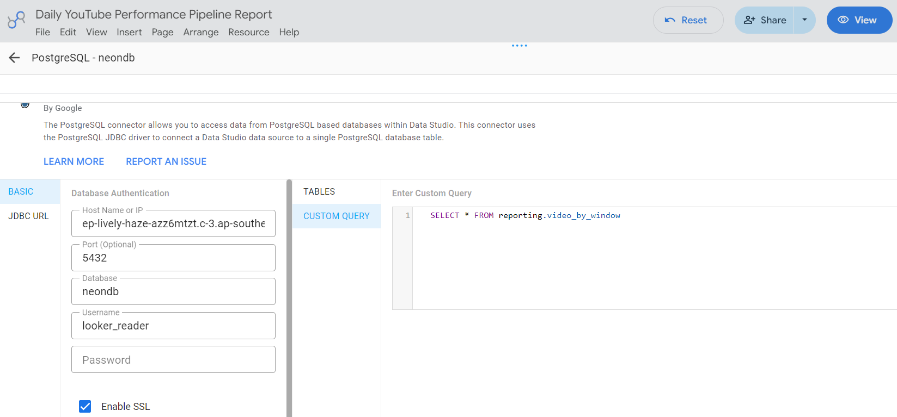
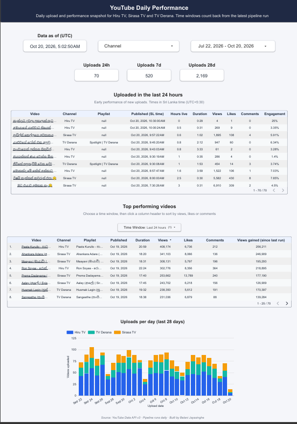

# Looker Studio Dashboard

This guide describes how the Looker Studio dashboard is built on top of the pipeline's
`reporting` views.

The dashboard reads **only** from these views. All business logic (time windows, rankings and
playlist selection) lives in version-controlled SQL ([sql/002_views.sql](../sql/002_views.sql)),
not in the BI tool.

## Contents

- [Data sources](#data-sources)
- [Connecting to the database](#connecting-to-the-database)
- [Configuring the data sources](#configuring-the-data-sources)
- [Report layout](#report-layout)
- [Components](#components)
- [Sharing](#sharing)

---

## Data sources

| View | Grain | Used for |
|---|---|---|
| `reporting.video_by_window` | One row per video **per time window** it falls in | Top-videos table, "uploaded in the last 24 hours" table, trend chart |
| `reporting.upload_summary` | Channel × time window (zero-filled) | Upload-count scorecards |
| `reporting.video_daily_dataset` | Video × capture date | Full daily dataset, trends and exports |
| `reporting.pipeline_runs` | One row per pipeline run | Run history and data freshness |

> **Reference time.** Time windows are measured back from the start of the **latest
> successful or partial run** (`reference_ts_utc`), not from the moment the report is opened. The
> figures therefore always agree with the data that was actually collected.

## Connecting to the database

Looker Studio runs in Google's cloud and cannot reach a `localhost` database, so the
pipeline uses a hosted PostgreSQL database (Neon).

### Credentials

The dashboard connects with the read-only `looker_reader` login, never the database owner
login. Create the login, or reset its password, with:

```bash
python -m yt_pipeline create-reader
```

The command prints the **host**, **port**, **database** and **username** required below.

### SSL certificate

Looker Studio needs Let's Encrypt's root certificate, **`isrgrootx1.pem`**, to connect to
Neon over SSL. Download it from https://letsencrypt.org/certs/isrgrootx1.pem.

## Configuring the data sources

Repeat the following for each of the four views:

1. **Create → Data source → PostgreSQL**.
2. **Basic** authentication:
   | Field | Value |
   |---|---|
   | Host | e.g. `ep-xxxx-xxxx.ap-southeast-1.aws.neon.tech` |
   | Port | `5432` |
   | Database | `neondb` |
   | Username | `looker_reader` |
   | Password | The password set with `create-reader` |

   If Looker Studio reports *"endpoint ID is not specified"*, use the pooled host instead (the
   same host with `-pooler` after the first segment). Pooling is safe here, because Looker
   Studio only reads.
3. Enable **Enable SSL** and upload `isrgrootx1.pem` as the server certificate.
4. Select **Custom query** and enter the view, for example:
   ```sql
   SELECT * FROM reporting.video_by_window
   ```
   A custom query avoids schema-listing issues with restricted logins.
5. **Connect**, then set the field types:

   | Field(s) | Type |
   |---|---|
   | `published_at_utc`, `data_capture_ts_utc`, `reference_ts_utc` | Date & Time |
   | `published_date_utc`, `data_capture_date` | Date |
   | `video_url` | URL |
   | `engagement_rate` | Percent |

   Optionally, add a calculated field for a clickable title:
   `HYPERLINK(video_url, video_title)`.
6. For `video_by_window`, set **Date range dimension** to `published_date_utc`.
7. Set **Data freshness** to **12 hours**, since the data changes once a day. After a manual
   pipeline run, **⋮ → Refresh data** loads the new figures immediately.



## Report layout

A single page holds all components:

```
┌────────────────────────────────────────────────────────────────────────────┐
│ YouTube Daily Performance                      Data as of: 2026-10-18 00:30 │
│ [Channel ▼]   [Date range: published ▼]                                     │
├──────────────┬──────────────┬──────────────────────────────────────────────┤
│ Uploads 24h  │ Uploads 7d   │ Uploads 28d                                   │
│      3       │      16      │      58                                       │
├──────────────┴──────────────┴──────────────────────────────────────────────┤
│ Uploaded in the last 24 hours (early performance)                           │
│ Title | Channel | Published (SL) | Hours live | Duration | Views | Likes | … │
├────────────────────────────────────────────────────────────────────────────┤
│ Top performing videos            [Time window: Last 24 hours ▼]             │
│ Rank | Title | Channel | Playlist | Published | Views | Likes | Comments     │
├────────────────────────────────────────────────────────────────────────────┤
│ Uploads per day (last 28 days): column chart by channel                     │
└────────────────────────────────────────────────────────────────────────────┘
```

The finished report:



## Components

### Header

| Component | Configuration |
|---|---|
| Title | Text: "YouTube Daily Performance" |
| Data as of | **Scorecard** on `video_by_window`; metric `MAX(reference_ts_utc)`; label "Data as of (UTC)" |

### Page-level controls

| Control | Configuration |
|---|---|
| Channel filter | **Drop-down list**; control field `channel_name` |
| Date range | **Date range control**; default **Advanced → Start: Today − 90 days, End: Today** |

Looker Studio's *Auto* and *Last 28 days* presets exclude **today**, which would hide the
newest uploads. The advanced range above includes it.

### Upload counts (24 hours / 7 days / 28 days)

Three **Scorecards** on `upload_summary`, each with metric `SUM(videos_uploaded)` and a chart
filter on `time_window`:

| Scorecard | Filter |
|---|---|
| Uploads 24h | `time_window = Last 24 hours` |
| Uploads 7d | `time_window = Last 7 days` |
| Uploads 28d | `time_window = Last 28 days` |

`upload_summary` returns `0` instead of "No data" when nothing was published.

For the channel filter to apply to these scorecards, both data sources must share the same
field ID for `channel_name`. PostgreSQL data sources do this by default. If they don't, align
the IDs under **Resource → Manage field names and IDs**.

### Uploaded in the last 24 hours

| Setting | Value |
|---|---|
| Chart | **Table** on `video_by_window` |
| Filter | `time_window = Last 24 hours` |
| Dimensions | `video_title` (hyperlink), `channel_name`, `playlist_name`, `published_at_colombo`, `hours_since_publish`, `video_duration` |
| Metrics | `view_count`, `like_count`, `comment_count`, `engagement_rate` |
| Sort | `published_at_utc`, descending |

### Top performing videos by time window

| Setting | Value |
|---|---|
| Chart | **Table** on `video_by_window` |
| Dimensions | `video_title`, `channel_name`, `playlist_name`, `published_date_utc`, `video_duration` |
| Metrics | `view_count`, `like_count`, `comment_count`, `views_gained_since_prev_capture` |
| Sort | `view_count`, descending; 25 rows per page |

Viewers can click any column header to re-sort by views, likes or comments.

The time-window selector is a **Drop-down list** with control field `time_window`, single
select, defaulting to "Last 24 hours". The table and this drop-down are **grouped**
(select both → right-click → **Group**). Grouped controls affect only the charts in their
group, so the upload scorecards are not filtered by the selector.

### Upload trend

| Setting | Value |
|---|---|
| Chart | **Column chart** on `video_by_window` |
| Filter | `time_window = Last 28 days` |
| Dimension | `published_date_utc` |
| Breakdown dimension | `channel_name` |
| Metric | `COUNT_DISTINCT(video_id)` |

## Sharing

| Option | How |
|---|---|
| Link access | **Share → Manage access** → anyone with the link can view |
| Static copy | **File → Download → PDF** |
